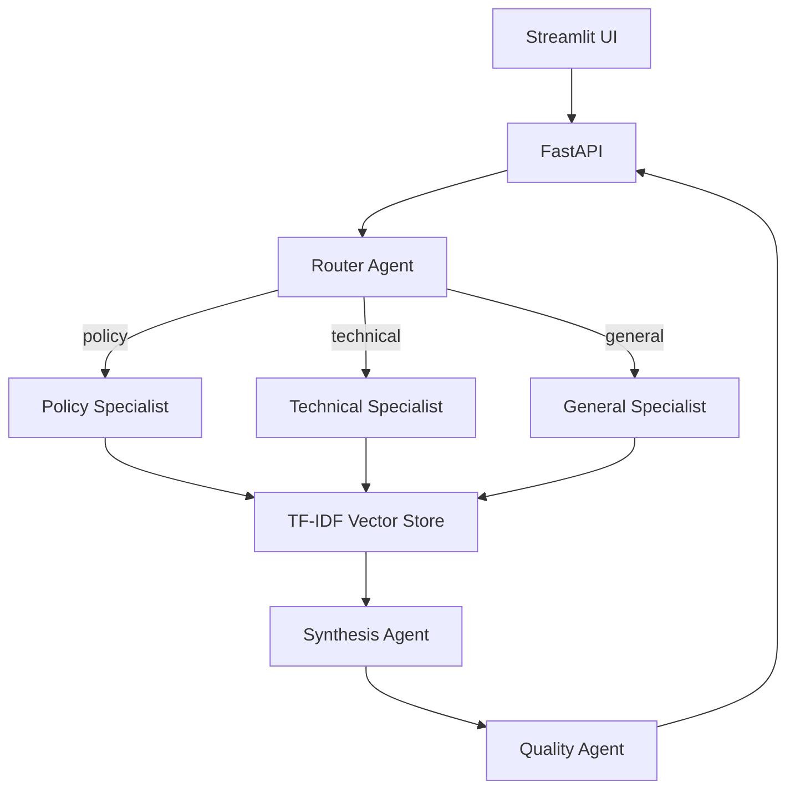

# Enterprise GenAI Agent Hub

[](https://github.com/lipsapriyadarsinee101-oss/enterprise-genai-agent-hub/actions/workflows/ci.yml)
[](https://www.python.org/)
[](https://fastapi.tiangolo.com/)
[](https://streamlit.io/)

An explainable multi-agent Retrieval-Augmented Generation (RAG) system for enterprise knowledge. It routes a business question through specialist agents, retrieves evidence, selects cited excerpts, and checks their provenance before returning the result.

**Built by [Lipsa Priyadarsinee](https://github.com/lipsapriyadarsinee101-oss)** as a portfolio project for Junior GenAI Engineer roles.

## Why this project matters

Enterprise GenAI systems need more than a chatbot. They need grounded answers, traceable evidence, modular APIs, evaluation, and safe failure behaviour. This portfolio prototype explores these concerns; it does not establish factual grounding or production readiness.

## Architecture



## Features

- Multi-agent workflow: router, retrieval specialist, synthesis, and quality agents
- RAG over Markdown and text documents with source citations
- OpenAI Responses API excerpt selection and a separate deterministic offline demo
- FastAPI endpoints with typed Pydantic contracts
- Streamlit chat UI with agent trace, citations, provenance status, and latency
- Lightweight TF-IDF retrieval—no external vector database required
- Prompt-injection-aware context handling
- Annotated evaluation for expected evidence, answer spans, and abstention
- Pytest suite, Docker Compose, health checks, and GitHub Actions CI

## Quick start

```bash
git clone https://github.com/lipsapriyadarsinee101-oss/enterprise-genai-agent-hub.git
cd enterprise-genai-agent-hub
python -m venv .venv
source .venv/bin/activate  # Windows: .venv\Scripts\activate
pip install -r requirements.txt
cp .env.example .env
uvicorn app.api:app --reload
```

In another terminal:

```bash
streamlit run streamlit_app.py
```

Open `http://localhost:8501`. Demo mode works without an API key. To enable generated answers, add `OPENAI_API_KEY` to `.env` and set `DEMO_MODE=false`.

## API

```bash
curl -X POST http://localhost:8000/v1/query \
  -H "Content-Type: application/json" \
  -d '{"question":"What controls are required before deploying an AI model?","top_k":3}'
```

Interactive API documentation is available at `http://localhost:8000/docs`.

| Endpoint | Method | Purpose |
|---|---|---|
| `/health` | GET | Service and knowledge-base status |
| `/v1/query` | POST | Run the agentic RAG workflow |
| `/v1/documents` | GET | List indexed knowledge sources |

## Evaluation

```bash
pytest -q
python -m scripts.evaluate --mode demo --output evaluation-results.json
```

`data/benchmark.json` is a versioned, authored set of ten cases covering deployment controls, monitoring, escalation, review frequency, oversight, recovery, absent knowledge, false premises, and instruction injection. Each case specifies expected source **and evidence text**, required/forbidden answer spans, and whether abstention is expected. These literal checks are diagnostic, not a semantic judge or a held-out accuracy estimate.

The demo never calls an LLM. It returns retrieved excerpts, so vocabulary overlap can produce irrelevant excerpts instead of abstention. The unknown-budget case intentionally exposes this limitation; do not interpret a successful script exit as all cases passing. Inspect individual `failures` and the summary, or use `--fail-on-case-failure` to enforce a benchmark gate. Execution errors always produce a nonzero exit.

To evaluate actual provider excerpt selection (incurs API usage), explicitly run:

```bash
python -m scripts.evaluate --mode llm --model YOUR_MODEL --output llm-results.json
```

This requires `OPENAI_API_KEY` and never falls back to demo. No live-provider results are claimed by the offline tests. JSON reports include every case, its annotations, output or error type, failures, wall-clock latency, mode/model/settings, code/corpus/case hashes, Python and library versions, and provider-reported token usage where available. Billed cost is `null`/unavailable: token counts alone are not an actual charge. Provider defaults and nondeterminism mean repeated LLM results may differ. `--cases` and `--knowledge-dir` support alternate fixtures.

### Quality contract and limitations

The quality agent checks the **candidate** before any abstention replacement:

- `citation_present` records source marker presence; `citations_valid` requires at least one marker and no unknown source names. Neither establishes claim support.
- `support_status=exact_extract` means every nonempty output line exactly matches a complete retrieved chunk formatted as `- <whitespace-normalized chunk> [source]`. Case, punctuation, numbers, and negation are preserved. This deliberately rejects paraphrases, partial quotations, unsupported additions, and incorrect facts even if their source marker is valid.
- Other statuses are `unverified`, `no_evidence`, and `abstained`. The service returns a fixed abstention for any candidate that is not an exact extract. `unmatched_blocks` retains rejected candidate text for inspection; it is not verified evidence.
- Exact extraction establishes only copying from the retrieved text. It does **not** verify source truth, relevance to the question, completeness, or resolve contradictory sources. Two conflicting exact extracts can pass this check. The UI always displays this limitation; human review remains necessary.

The LLM now selects complete excerpts or abstains, rather than freely synthesizing prose. This is intentionally restrictive and may reject otherwise valid answers. Demo mode does not reason about sufficiency or conflicts. Retrieval remains TF-IDF with score > 0, not an answerability detector.

API compatibility: existing `answer`, `route`, `citations`, `trace`, `latency_ms`, and `mode` remain. `citations` lists retrieved evidence, including full chunk text; it is not a list of verified claims. Deprecated `confidence` and `grounded` remain present but are now nullable and always `null`: there is no calibrated confidence or semantic grounding verifier. Clients must accept nulls and use the new `quality`, `abstained`, and `usage` fields. The Streamlit UI is updated accordingly. Setting `DEMO_MODE=false` without a key now fails explicitly at startup.

## Technology stack

Python, FastAPI, Streamlit, OpenAI API, scikit-learn, Pydantic, Docker, Pytest, and GitHub Actions. The orchestration layer uses framework-independent agent interfaces so a LangChain, Azure OpenAI, AWS Bedrock, or GCP implementation can be added through an explicit provider adapter.

## Responsible AI choices

- Retrieved documents are treated as untrusted data, not executable instructions.
- The service abstains on empty retrieval and candidates that fail the bounded extraction check; answerability is not guaranteed.
- Provider outputs must copy complete cited excerpts or abstain.
- The quality agent separates citation validity from extraction matching; factual support remains unverified.
- Secrets are read from environment variables and never committed.

## Roadmap

- Hybrid dense + keyword retrieval with reranking
- PDF and DOCX ingestion
- LangSmith or OpenTelemetry traces
- Azure OpenAI deployment adapter
- Human feedback and evaluation dashboard

## License

MIT

